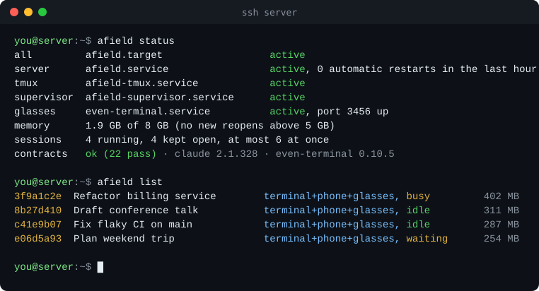

# afield

[](https://github.com/chanyaoying/afield/actions/workflows/tests.yml)

*Unofficial. Not affiliated with or endorsed by Anthropic or Even Realities. Claude and Claude Code
are trademarks of Anthropic, PBC.*

One Claude Code conversation, open everywhere at once: in an SSH terminal, in the Claude phone
app and on Even G2 glasses. It stays up across crashes and reboots, so you can step away from the
desk and pick the work up wherever you are.



afield used to be called claude-rc.

## Who this is for

You run Claude Code on an always-on machine (a homelab box, a home server) and want to pick up
the *same* conversations from wherever you are. That might be a terminal at your desk, your phone
on the go, or smart glasses. afield is a single-user, personal setup. It needs systemd
(`--user` services), tmux, Python 3 and a Claude Code login with Remote Control. Even Terminal is
needed only if you use the glasses.

## The problem it solves

Claude Code can reach a conversation from all three places, but each place starts its own
process. Left alone, that goes wrong in several ways:

- **Phone-started chats are invisible at the terminal.** Remote Control runs them as headless
  children of its server, with no window you can attach to.
- **Terminal chats die with your SSH connection,** and you can't reach them from the phone unless
  you remembered to start them with Remote Control.
- **Glasses chats are separate processes** run by Even Terminal, so they reach neither the terminal nor the phone.
- **Two processes on one conversation conflict.** Their writes to the transcript clash, and the
  phone can end up with duplicate entries or a new link.
- **A reboot or crash ends everything.** A machine shutdown even archives every chat on the phone,
  and nothing comes back by itself.

afield keeps **exactly one process per conversation**, in a tmux window, connected to the
phone (Remote Control) and the glasses (Even Terminal) at the same time. A small supervisor checks
every 5 seconds and does three things:

- It moves phone- and glasses-born chats into windows once they go quiet.
- It brings sessions back on their *original* phone link after a crash or reboot.
- It keeps the phone's archive in step.

You type in whichever place is at hand, and the other two follow.

### Where a message goes

- **To an existing session, from any of the three:** it goes into the one process, and the other
  two see it straight away.
- **A new chat from the phone or the glasses:** it starts outside tmux. Once it has been idle for
  5 s, the supervisor moves it into a window on the same phone link, so it's on all three about
  5–10 s after its first reply.
- **A new chat from the terminal:** use `afield new [title]`, which starts it in a window with a
  phone link at once.

## How it works

Keeps every Claude Code session on that machine in **one copy**, reachable from
three places at once and surviving restarts and reboots:

| Where | How it reaches the session |
|---|---|
| SSH terminal | a tmux window (`afield` attaches) |
| Phone (Claude app) | Remote Control link (`claude.ai/code/session_…`) |
| Even G2 glasses | Even Terminal's wrapper types glasses prompts into the same TUI |

Each session is one interactive process:

```
even-terminal claude --resume <uuid> --remote-control
```

It runs in a tmux window tagged `@afield_uuid=<uuid>` on the private tmux server
`-L afield`, in session `rc`. The phone, terminal and glasses all talk to that one process.

## Lay of the land

```
systemd --user: afield.target groups them; all in afield.slice (MemoryHigh 6G, MemoryMax 8G)
├── afield.service            claude remote-control --no-create-session-in-dir   (cwd ~/afield)
│     where phone-started sessions are born, as headless children
├── afield-tmux.service       tmux -L afield new-session -d -s rc -n shell
│     window 0 = plain shell, one window per session after that
├── afield-supervisor.service python3 -I ~/.local/bin/afield supervise   (5 s tick)
│     reconciles the registry against processes and windows
├── even-terminal.service        OPTIONAL (install.sh --with-even): Even server on :3456 for the
│                                glasses; it also runs the glasses' per-turn Claude processes
└── afield-even-proxy.service    with Even and glasses_only_afield: takes the glasses' address
                                 (Even stays on 127.0.0.1) so they list only afield's sessions
```

`systemctl --user start|stop|restart afield.target` starts or stops everything at once
(stopping stops every session; they come back on their phone links when it starts again).

Why separate units: tmux holds the sessions, so the supervisor can restart (every code change)
without touching them; the RC server is Claude Code's own process; Even is an optional add-on
with its own lifecycle. One timing rules everything the supervisor does with a session that has
gone quiet: **idle 5 s** (`IDLE_MS`), checked every 5 s, so a phone or glasses session is in its
window 5–10 s after its last reply.

### Even Terminal (optional)

Only the glasses need it. Without it, sessions run in the terminal and on the phone as usual,
started as plain `claude --resume <uuid> --remote-control`.

- Not installed or disabled: sessions start without the wrapper straight away. Sessions that
  were started with it are reopened without it.
- Installed but down (e.g. at boot): the supervisor waits up to 90 s, then starts without it.
- When it is up again, every session that started without it *only because it was down* is put
  back on the wrapper once it is idle (`should_rewrap`). A session started without the wrapper on
  purpose (the last of 3 launch attempts) is left alone.
- The unit runs `even-terminal` directly (`Restart=always`, in the slice). Its startup banner
  prints the full auth token and a pairing QR code, so stdout is discarded; the log is
  `~/.even-terminal/logs/even-terminal.log`, and `even-terminal config` shows pairing details.

State:

| Path | What |
|---|---|
| `~/.local/state/afield/registry.json` | one entry per session: state, host, link, title, Even instance… |
| `~/.local/state/afield/registry.lock` | flock shared by the supervisor and every CLI command |
| `~/.local/state/afield/adopt-since` | glasses sessions created before this time are never adopted |
| `~/.claude/sessions/*.json` | Claude Code's own live-process records (pid, status, bridgeSessionId) |
| `~/.claude/projects/<cwd>/<uuid>.jsonl` | transcripts; the last `bridge-session` line picks the phone link |
| `~/.even-terminal/instances/*.json` | identity of the running Even server (pid:startedAt) |

### What the supervisor does each tick

1. **Duplicates.** It stops a headless server child whose transcript is already open in a window.
2. **Records live sessions.** It classifies each process as `tmux`, `server`, `daemon` or `external`.
3. **Refreshes titles** (only with `phone_titles` on). It refreshes phone titles from `GET /v1/sessions/<link>`, which renames the windows.
   The titles and the archive list are fetched *before* the tick takes the registry lock
   (`prefetch`), so a slow API never holds up CLI commands.
4. **Archive sync, every 60 s** (only with `archive_sync` on). A *running* session that the app shows as `archived` is retired.
5. **Moves sessions into windows.** This covers an idle (5 s) phone child, a handed-over terminal session, or an old `--bg` job.
   The supervisor stops the process, makes sure the transcript's last `bridge-session` line names
   the existing link, then launches it in a window. The phone keeps the same entry and title.
   **One copy per session.** A chat started on the phone stays tied to the server it was created
   on. While that server runs, the cloud gives every new phone message for the chat to the
   server, not to the window. The server then starts a second copy, which takes over the phone
   connection (the window stands down, code 4090), while the window finishes the reply it was in.
   So once the server is empty again, and each moved window has been up a minute, holds its phone
   link and is idle, the supervisor restarts it (a few seconds, no chat interrupted), and from then on the phone reaches the chat in its window only. Until then, if a
   server copy appears while the window is still working, the supervisor presses Esc in the window
   to stop that reply. Nobody sees it, but it would otherwise keep editing files.
6. **Adopts glasses sessions.** These are `entrypoint: sdk-ts` transcripts, idle 5 s, created after `adopt-since`.
   A glasses turn registers as a live process while it runs, so it is never taken mid-turn.
7. **Reopens sessions.** It reopens sessions that died, plus everything after a tmux/server/Even restart or a reboot.
   It starts one per tick, at most 6 running, only transcripts younger than 14 days, and only while the slice's working set (memory minus reclaimable file cache) is under 5 GB.
   After 3 failed attempts a session is marked `failed`; the last attempt runs without the Even wrapper.
8. **Relaunches windows that need it** (idle 5 s): one whose Remote Control stood down (code 4090)
   or otherwise lost its phone link (its session file no longer has `bridgeSessionId`; `afield list`
   shows `PHONE DISCONNECTED`),
   and one that started without the glasses because Even was down, once Even is back.
9. **Window upkeep.** It closes dead or duplicate windows, renames windows, and auto-answers the trust prompt, only for the folders in `auto_trust_dirs` (none by default).
   It also answers Claude Code's "Teach auto mode about your environment?" pop-up with "Don't
   show again" (and closes its setup screen with Esc). The glasses send a message as typing plus
   Enter, so while that pop-up is open the Enter answers it and the message is lost. Contract SCREEN-2.
10. **Server health.** It logs every automatic restart of the Remote Control server; `afield status` warns at 3 in an hour.

Before each tick it also checks the **contracts** (see "Contract tests" below):
- at start
- when the `claude` or `even-terminal` version changes
- every 6 hours

With `alerts_url` set, a new contract failure (and the all-clear after it; "changed" is not sent)
is sent to your webhook, so it reaches your phone (see "Alerts" under Configuration).

While a critical contract fails, steps 4, 5 and 6 pause, along with writing `bridge-session`
lines. Steps 7 to 9 keep running.

### Session states (`registry.json`)

| state | meaning |
|---|---|
| `open` | should be running; the supervisor keeps it up |
| `closed` | you exited it (it stopped while its host was unchanged); not reopened |
| `failed` | 3 launch attempts failed; `afield reopen` |
| `forgotten` | a marker, kept so the session is never re-adopted; `--revive` brings it back |

## Commands

```
afield                       attach to the tmux view (one window per session)
afield new [title]           start a new session in ~/afield with its own window and phone link
afield open <name|id>        attach, focused on one session (moves/reopens it first if needed)
afield open --revive <id>    same, for a forgotten or never-tracked session
afield list                  tracked sessions: id, name, where it runs (or starting / queued /
                                failed), its memory (RSS), phone link
afield list --all            also forgotten + untracked chats from the last 14 days, with their
                                first prompt: the ids to give --revive
afield status                services, Remote Control server health (automatic restarts in the
                                last hour), Even up/down, slice memory, sessions vs the cap, phone
                                API on/off, contracts
afield status --json         the same as JSON, for scripts and monitoring
afield config [key]          the settings in use: defaults + ~/.config/afield/config.json
afield config set <key> <value...>
                             check and save one setting; restarts the supervisor when that is
                                all it needs, otherwise says whether ./install.sh or a full
                                restart is needed
afield config unset <key>    put a setting back to its default (same rules)
afield config help           every setting: value, default, what a change needs
afield logs                  follow the supervisor log (journalctl)
afield doctor                run the contract tests: is everything afield relies on in Claude
                                Code, Even, tmux and systemd still the way it was? (CONTRACTS.md)
afield doctor --e2e          also end to end: a throwaway session, its link kept across a resume,
                                then archived and removed (adds one short-lived chat to the phone)
afield doctor --candidate P  check a claude binary before switching to it (static checks)
afield doctor --update-snapshot   accept today's shapes as the baseline (commit the file)
afield help                  usage
afield reopen <name|id>      bring back a closed / failed / dormant session
afield reopen --revive <id>  same, for a forgotten or never-tracked session (finds its transcript)
afield adopt <id>            hand over a session running in a plain terminal; once idle 5 s it
                                is stopped there and resumed in a window
afield adopt --revive <id>   same; if it is not running anywhere, revive + reopen it
afield forget <name|id>      stop tracking (transcript and phone entry stay)
afield retire [name|id]      forget + close the window 5 s later (+ archive in the app, with retire_archives)
                                (no argument: the session you run it from)
afield supervise             the supervisor loop (`keep` is an old alias)
/afield-retire [name|id]        slash command for the same, from inside any session
```

In tmux: `Ctrl-b n` / `p` next / previous, `Ctrl-b w` pick, `Ctrl-b d` detach (sessions keep running).

Logs: `afield logs` (= `journalctl --user -u afield-supervisor -f`).

If a command prints "waiting for the supervisor…", the supervisor is in the middle of moving or
starting a session (a few seconds, rarely up to a minute). It continues by itself.

## Configuration

Every setting is optional; `afield config` prints the ones in use and `afield config help`
describes each. Change one with `afield config set <key> <value>` (or `unset <key>` for the
default): it checks the value, saves it and, for keys only the supervisor reads (`max_open`,
`defer_above_gb`, `idle_seconds`, `archive_sync`, `phone_titles`, `auto_trust_dirs`), restarts
the supervisor, which leaves sessions running. For the rest it says what to run: `memory_max_gb`
needs `./install.sh`; `served_dir`, `even_port` and `glasses_only_afield` need `./install.sh` and
only fully apply once the services restart, which restarts every session.

You can also edit `~/.config/afield/config.json` (or `$AFIELD_CONFIG`) by hand, then rerun `./install.sh`, which passes
the ones systemd needs to the units as drop-ins (`~/.config/systemd/user/<unit>.d/50-afield-config.conf`)
and restarts the supervisor. A key it does not know, or a value of the wrong type, is ignored and
shown by `afield status`.

| Key | Default | What it does |
|---|---|---|
| `served_dir` | `"~/afield"` | the folder the Remote Control server serves; new sessions run here |
| `even_port` | `3456` | Even Terminal's port |
| `max_open` | `6` | sessions running at once (each costs roughly 300–500 MB) |
| `memory_max_gb` | `8` | hard memory cap for all sessions together (`afield.slice`; soft limit at 75%) |
| `defer_above_gb` | `5` | no more reopens once the sessions use this much |
| `idle_seconds` | `5` | idle this long before a session is moved, adopted or relaunched |
| `archive_sync` | `false` | archiving a chat in the app retires it here |
| `phone_titles` | `false` | name windows after the chat's title in the app |
| `retire_archives` | `false` | `afield retire` also archives the chat in the app (see the warning below) |
| `alerts_url` | `""` | webhook told when a contract fails or passes again; empty: off (see "Alerts") |
| `alerts_format` | `"json"` | `json`, `ntfy`, `slack` or `discord` |
| `alerts_secret_file` | `"~/.config/afield/alerts-secret"` | `json`: HMAC key requests are signed with; `ntfy`: access token. Optional |
| `glasses_only_afield` | `true` | the glasses list only the sessions afield keeps open, under their phone titles (see below) |
| `auto_trust_dirs` | `[]` | folders whose "trust this folder?" prompt is answered yes, e.g. `["~"]` (Claude Code never saves trust for the home folder, so it asks there on every launch) |

> **At your own risk: `archive_sync`, `phone_titles` and `retire_archives`.** These three call
> Anthropic's undocumented sessions API (`api.anthropic.com/v1/sessions`, a beta) **with your own
> Claude login**: the OAuth token Claude Code keeps in `~/.claude/.credentials.json`. That API is
> not public, can change or disappear without notice, and using your login from a tool other than
> Claude Code may not be allowed by the terms that apply to your account. Check them before you
> turn any of these on. They are all off by default; with them off, afield never calls that API
> and never reads the token. `afield doctor` checks the API (API-1, API-2) only while one is on.

With everything off, `afield retire` closes the window and stops tracking the chat, and you
archive it in the app yourself.

Example, with all three on:

```json
{"archive_sync": true, "phone_titles": true, "retire_archives": true, "auto_trust_dirs": ["~"]}
```

**The glasses' session list.** The glasses ask Even Terminal for its sessions, and Even lists the
newest transcripts of every project, each under its transcript title. A window's
`--remote-control` without a name writes the folder's name as that title (`claude-rc-eb`), so the
phone's title never shows. With `glasses_only_afield` on, `install.sh` keeps Even on 127.0.0.1
(`EVEN_HOST_MODE=interface`, `lo`) and starts `afield-even-proxy.service` on the address Even used
to take (from `network` in `~/.even-terminal/config.json`; tailscale, lan or interface). The proxy
passes the glasses' requests on and rewrites only `GET /api/sessions`: the sessions afield keeps
open, under their phone titles. Even trusts 127.0.0.1 for its hook endpoint and its wrappers'
WebSocket, so the proxy passes on only token-checked `/api/` routes, never `claude-sync` and never
an Upgrade. Contracts EVEN-4 and EVEN-5 cover what it relies on.

**Alerts.** afield can tell you when a contract fails (and when they all pass again), so a
Claude Code update that breaks something reaches your phone instead of only the log. Each failure
is sent once; a send that fails is retried every 10 minutes. Pick one:

| `alerts_format` | `alerts_url` | `alerts_secret_file` |
|---|---|---|
| `ntfy` | `https://ntfy.sh/<a long random topic>` or your own ntfy server | optional access token |
| `slack` | a Slack incoming-webhook URL | not used |
| `discord` | a Discord channel webhook URL | not used |
| `json` | anything that takes a POST of `{"source", "title", "text"}` (a Lambda function URL, n8n, Home Assistant, ...) | optional HMAC key |

What `alerts_secret_file` is for depends on the format. It is optional for all of them, and it
is a file (mode 600) rather than a setting so the secret never lands in `config.json`, which
`afield config` prints:
- **`json`:** a shared key both sides know. afield never sends it: it signs each request with it
  (below), and your receiver checks the signature, so nobody who finds the URL can send you fake
  alerts or replay old ones.
- **`ntfy`:** an access token for a protected topic, sent as `Authorization: Bearer <token>`.
- **`slack`, `discord`:** not used. The webhook URL itself is the secret.

After any change, `afield alert test` sends one message; the supervisor uses the new settings at
once (`afield config set` restarts it).

**ntfy, public topic** (install the ntfy app and subscribe to the same topic; pick a long random
name, since anyone who knows it can read and post):

```sh
afield config set alerts_format ntfy
afield config set alerts_url https://ntfy.sh/afield-7f3c9e1b2d
afield alert test
```

**ntfy, your own server with a protected topic:**

```sh
install -m 600 /dev/null ~/.config/afield/alerts-secret
printf '%s' 'tk_your_access_token' > ~/.config/afield/alerts-secret
afield config set alerts_format ntfy
afield config set alerts_url https://ntfy.example.com/afield
afield alert test
```

**Slack or Discord** (create an incoming webhook for a channel, then):

```sh
afield config set alerts_format slack      # or: discord
afield config set alerts_url https://hooks.slack.com/services/T000/B000/XXXX
afield alert test
```

**Your own endpoint, signed** (a serverless function, n8n, Home Assistant, a small web app):

```sh
install -m 600 /dev/null ~/.config/afield/alerts-secret
openssl rand -hex 32 > ~/.config/afield/alerts-secret    # give the receiver the same key
afield config set alerts_format json
afield config set alerts_url https://alerts.example.com/afield
afield alert test
```

afield then POSTs `{"source": "afield on <hostname>", "title": "...", "text": "..."}` with two
headers: `X-Timestamp` (Unix seconds) and `X-Signature: hex(HMAC-SHA256(key, "<timestamp>.<raw
body>"))`. The key itself is never sent. The receiver recomputes the signature over the exact
bytes it received, compares in constant time, and refuses old timestamps. In Python:

```python
import hashlib, hmac, time

def is_from_afield(key: bytes, headers: dict, body: bytes, max_age=300) -> bool:
    stamp = headers.get("x-timestamp", "")
    if not stamp.isdigit() or abs(time.time() - int(stamp)) > max_age:
        return False  # missing, or too old: a replay
    expected = hmac.new(key, stamp.encode() + b"." + body, hashlib.sha256).hexdigest()
    return hmac.compare_digest(expected, headers.get("x-signature", ""))
```

Without a secret file, `json` requests go unsigned; use that only for an endpoint that checks
something else, or one only this machine can reach (`alerts_url` may be `http://` only to this
machine, e.g. `http://localhost:8080/afield`). To turn alerts off: `afield config unset alerts_url`.

**Push notifications** come from Claude Code itself, not afield. Turn them on in `/config`
("Push when Claude decides", "Push when actions required"), or in `~/.claude/settings.json`:
`"agentPushNotifEnabled": true` and `"inputNeededNotifEnabled": true`. The second toggle may not
show in `/config` for every account yet. Pushes are skipped while you are active in the terminal.

## Repository layout

```
bin/afield                     the CLI + supervisor (Python, stdlib only)
lib/afield_contracts.py               the contract tests that `afield doctor` and the supervisor run
CONTRACTS.md                      every assumption about Claude Code / Even / tmux / systemd, by ID
contracts/snapshot.json           the shapes seen on the last good versions (the baseline for diffs)
tests/test_afield.py           decision tests: python3 -I tests/test_afield.py
tests/test_contracts.py           contract-test tests: python3 -I tests/test_contracts.py
systemd/                          the four live units + the slice
claude/commands/afield-retire.md  /afield-retire
claude/skills/afield/SKILL.md  explains this system to Claude sessions
install.sh                        symlink the live paths to this repo (keeps what it replaces as *.pre-repo, untracked),
                                  write the config drop-ins, enable afield.target
uninstall.sh                      stop and remove it all (keeps config, state and transcripts)
.github/workflows/tests.yml       CI: both test files on every push; nightly static contracts on the newest Claude Code
CHANGELOG.md · CONTRIBUTING.md · SECURITY.md
```

The tests use `$AFIELD_SCRIPT` if it is set, then `../bin/afield`, then
`~/.local/bin/afield`.

To run a second supervisor against a throwaway folder, set
`AFIELD_DIR`, `AFIELD_STATE`, `AFIELD_TMUX` and `AFIELD_SERVER_UNIT`.

## Contract tests

afield depends on internals nobody promised to keep stable: session files, transcript records, a
beta API, CLI flags, on-screen text, and Even's wrapper. Each assumption is a contract with an ID in
[CONTRACTS.md](CONTRACTS.md), which also says why afield needs it, what breaks and how to fix it.

`afield doctor` checks all of them in about 2 s:
- **static:** the flags in `--help`, and the names inside the claude binary
- **live:** session files, transcripts, the sessions API (GET only), tmux, systemd, cgroups

`--e2e` adds a throwaway session to prove links survive a resume and archiving works.

Results compare against `contracts/snapshot.json`, so a change is reported as a diff, e.g.
`keys: +remoteSessionId -bridgeSessionId`, not just as pass or fail. The supervisor runs the
same checks on its own after every version change, and pauses the risky actions while a critical
one fails. `afield status` shows the last result.

Before upgrading Claude Code, run `afield doctor --candidate ~/.local/share/claude/versions/<new>`.
A broken contract is the playbook in CONTRACTS.md, step by step.

## Verified behaviour

Tested on CLI 2.1.319 and even-terminal 0.10.5. Each of these broke the setup once; the contract
tests (CONTRACTS.md) now check the ones that can be checked:

- Interactive `--resume --remote-control`, wrapped or not, keeps the session's existing link.
- The server runs with `--no-create-session-in-dir`, because a server-owned session gets
  reattached on restart, and that reattach rewrote the transcript from `ccr-tip.json`.
- `--continue` forces single-session mode and auto-sends a prompt. Never use it.
- There's no `--name` on resume: the phone title is the name, and the windows follow it.
- A clean exit archives the chat. A machine shutdown archives every chat, and reopening un-archives it.
  So archive sync only retires sessions that are **running**. To retire a session while the machine
  is down, type `/afield-retire` in the chat.
- When the Even server restarts, every wrapper exits. Sessions record their Even instance and
  are reopened when it changes.
- Even Terminal runs fine without a terminal (tested 2026-11-09 under plain systemd on a second
  port: it listened on localhost and Tailscale).
- "This folder is already served…" is a lease that clears after a few minutes.
- A revived old chat may deliver a phone message that was queued while it was disconnected.
- A phone-started chat's record (`GET /v1/sessions/<link>`, `environment_id`) names the server
  process that created it, and stays that way after the chat moves into a window. While that server
  runs, each phone message for the chat starts a server copy, even with the window connected
  (2026-11-15: 7 times in one chat, and two copies edited the same files). The server copy also
  rebuilds the local transcript from the cloud, which drops the window's latest turns. After the
  server restarts (new environment), messages reach the window: 19 of 19 takeovers since
  2026-11-09 happened while the creating server was still running.

## Install

Needs: Linux with systemd user services (`loginctl enable-linger $USER` so they run without a
login) and cgroup v2 (for the memory cap), tmux, Python 3.10+, Claude Code signed in with a plan that includes Remote Control (see
the [Remote Control docs](https://code.claude.com/docs/en/remote-control)). Even Terminal (`npm i -g @evenrealities/even-terminal`) only for the
glasses.

```
./install.sh                 core: RC server, tmux, supervisor (an installed Even is kept)
./install.sh --with-even     also Even Terminal, for the Even G2 glasses
./install.sh --without-even  remove Even Terminal
```

Upgrading from claude-rc: run `install.sh` from outside a session (`systemd-run --user ./install.sh`).
It stops the old units, which ends every session for about a minute while the new supervisor brings
them back on their phone links. It moves `~/.config/claude-rc` to `~/.config/afield` and
`~/.claude/rc-sessions` to `~/.local/state/afield`, and keeps serving `~/claude-rc`, where your
existing transcripts are filed.

Installing, removing or migrating Even restarts the glasses wrapper and with it every session
that uses it (they come back on their links in about a minute), so run it from outside a session:
`systemd-run --user ~/Projects/afield/install.sh --with-even`.

The live paths are symlinks into this checkout, so this repo **is** the running system:

| Live path | Repo file |
|---|---|
| `~/.local/bin/afield` | `bin/afield` |
| `~/.local/share/afield/test_afield.py` | `tests/test_afield.py` |
| `~/.config/systemd/user/{afield.slice,afield.target,afield*.service,even-terminal.service}` | `systemd/` |
| `~/.config/systemd/user/<unit>.d/50-afield-config.conf` | written from the config (not a link) |
| `~/.claude/commands/afield-retire.md` | `claude/commands/afield-retire.md` |
| `~/.claude/skills/afield` | `claude/skills/afield` |

The files that were replaced are kept as `*.pre-repo`. `./install.sh` is idempotent: rerun it
if a live path stops being a symlink (`sed -i` or `mv` onto it does that; Claude's Edit tool
refuses to write through a symlink and names the repo file instead). It restarts only the
supervisor.

To remove it: `./uninstall.sh --yes`, from outside a session. It stops every session (transcripts
stay) and deletes the links and drop-ins. It keeps `~/.config/afield` and `~/.local/state/afield`.

After changing `bin/afield` or `lib/afield_contracts.py`: run both test files and `afield doctor`,
then `systemctl --user restart afield-supervisor`
(sessions keep running), then commit. After changing a unit: `systemctl --user daemon-reload`.

## Licence

MIT; see [LICENSE](LICENSE).
